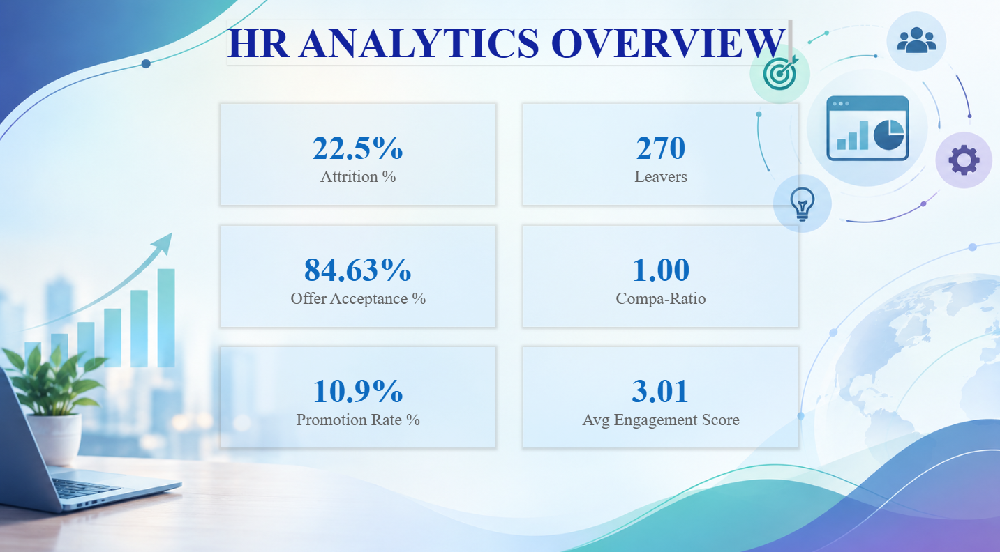
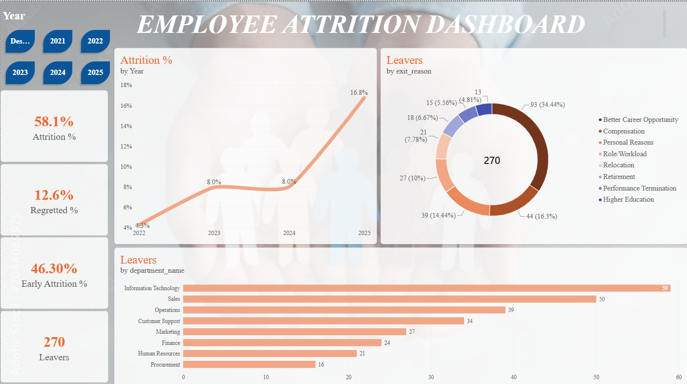
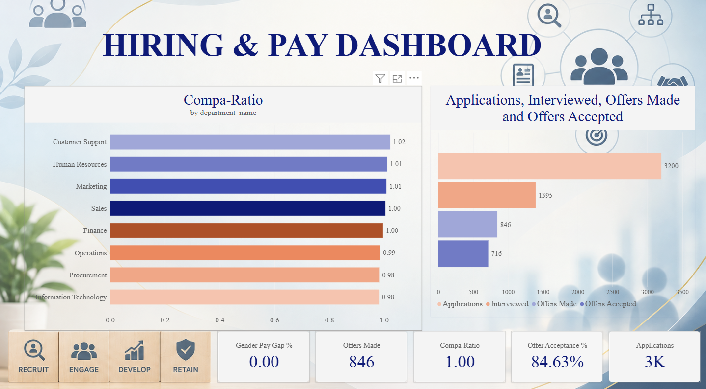
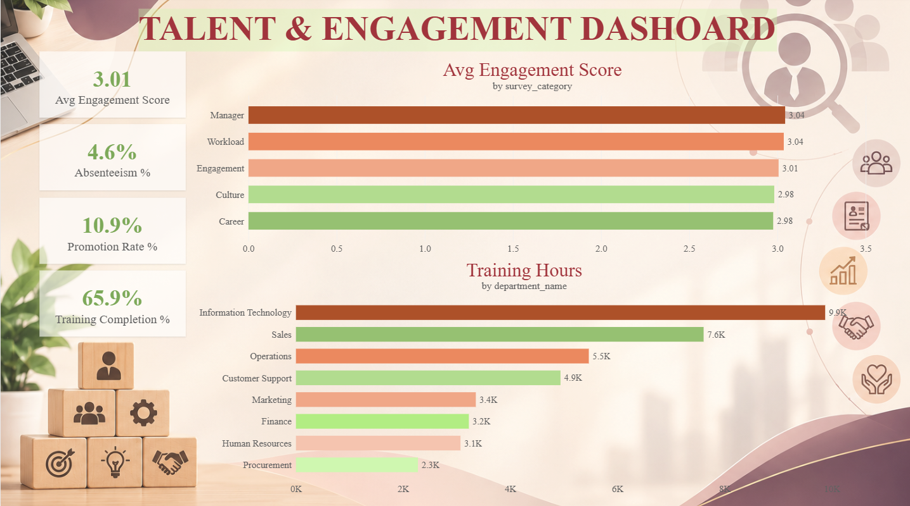
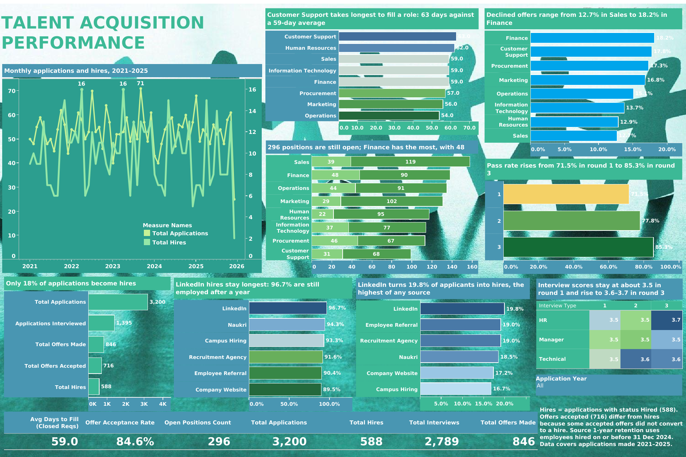

# HR Analytics: From Raw Data to Decisions

**SQL analysis, Power BI and Tableau dashboards on one 1,200-employee HR dataset**

Ankita (Ankitha_S) Shinde · People Analytics

---

## Executive Summary

A mid-sized company with 1,200 employees has a **22.5% attrition rate**, slow hiring and no single view of its people data. This project answers the questions the CHRO, Finance, Talent Acquisition and department heads ask, and turns the answers into actions.

- **Attrition is rising.** Annual attrition climbed from 4.3% in 2022 to 16.8% in 2025.
- **Early exits are the biggest leak.** 46% of leavers quit within 12 months of joining.
- **Career growth drives exits.** "Better Career Opportunity" accounts for 34% of exits, more than any other reason.
- **Hiring is selective and slow.** 3,200 applications produce 588 hires (18.4%), and a vacancy takes 59 days to fill on average.
- **Some sources retain better.** LinkedIn hires have the best one-year retention (96.7%); Company Website hires have the lowest (89.5%).

---

## Business Problem

The company has no shared view of its people data. Leadership cannot see where people leave, why, or how early, and Talent Acquisition cannot tell which channels are worth their cost. As People Analytics analyst, the goal is to answer those questions with reproducible SQL and two decision-ready dashboards.

---

## Key Findings and Recommendations

| # | Finding | Evidence | Recommendation |
|---|---|---|---|
| 1 | Attrition is 22.5% and rising | 270 of 1,200 employees left; annual rate 4.3% (2022) → 16.8% (2025) | Treat attrition as a 2025 priority and track it quarterly |
| 2 | Early exits dominate | 46% of leavers left within 12 months | Redesign onboarding; add a 90-day check-in |
| 3 | Career growth is the main exit driver | Better Career Opportunity: 34% of exits; Compensation: 16% | Publish visible career paths; review pay bands |
| 4 | Finance has the highest attrition rate | 24.7%, the highest of any department | Focus retention on Finance and Procurement |
| 5 | IT and Sales lose the most people | 59 and 50 leavers respectively | Target stay interviews in these teams |
| 6 | Pay sits at or below the midpoint in some teams | Compa-ratio 0.98 in IT and Procurement; 1.02 in Customer Support | Review pay positioning in IT and Procurement |
| 7 | Hiring converts 18.4% of applications | 3,200 applications → 588 hires; offer acceptance 84.6% | Shorten the funnel where candidates drop out |
| 8 | Customer Support is the slowest to fill | 63 days against a 59-day average | Add recruiter capacity or agencies for this team |
| 9 | LinkedIn is the strongest source | Best conversion (19.8%) and retention (96.7%) | Shift hiring budget towards LinkedIn |
| 10 | Training has no measurable performance lift | Scores flat at about 3.4 | Review L&D programmes for impact |
| 11 | 24 high performers are at risk | High performance, low engagement, paid below role midpoint | Start stay conversations now |

---

## Dashboards

### Power BI: HR Analytics Dashboard (4 pages)

#### Page 1: Overview

Six headline measures for a five-second read: attrition, leavers, offer acceptance, compa-ratio, promotion rate and average engagement.



#### Page 2: Attrition

Answers who is leaving, why, and in which teams.

- **Annual attrition** rose from 4.3% in 2022 to 16.8% in 2025.
- **Exit reasons:** Better Career Opportunity (93, 34%), Compensation (44, 16%), Personal Reasons (39, 14%), Role/Workload (27, 10%).
- **Leavers by department:** Information Technology (59), Sales (50), Operations (39), Customer Support (34).
- **Early attrition** is 46.3% and **regretted attrition** (high performers who left) is 12.6%.



#### Page 3: Hiring and Pay

Shows pay positioning by department and the hiring funnel from application to acceptance.

- **Compa-ratio by department** ranges from 0.98 (IT and Procurement) to 1.02 (Customer Support).
- **Funnel:** 3,200 applications → 1,395 interviewed → 846 offers made → 716 accepted.
- **Offer acceptance:** 84.63%.



#### Page 4: Talent and Engagement

Links engagement, promotion, absence and training to the workforce.

- **Average engagement score:** 3.01. Manager and Workload score highest (3.04); Culture and Career lowest (2.98).
- **Promotion rate:** 10.9%. **Absenteeism:** 4.6%. **Training completion:** 65.9%.
- **Training hours** are highest in Information Technology (9.9K) and Sales (7.6K).



### Tableau: Talent Acquisition Performance

**Interactive dashboard:** [View on Tableau Public](https://public.tableau.com/app/profile/ankitha.s3064/viz/Talent_Acquisition_Performance_DB/Dashboard1?publish=yes)

Answers where hiring is slow or leaky, and which sources deliver quality hires.

- **Funnel:** 3,200 applications, 2,789 interviews, 846 offers, 588 hires.
- **Speed:** 59.0 days to fill (closed requisitions); 296 positions still open, with Finance holding the most (48).
- **Declined offers** range from 12.7% (Sales) to 18.2% (Finance), about 15% overall.
- **Sources:** LinkedIn converts 19.8% of applicants to hires; Company Website retains the fewest hires after a year (89.5%).
- **Interview quality:** pass rate rises from 71.5% in round 1 to 85.3% in round 3, consistent with weaker candidates being screened out early.



---

## SQL Analysis

The SQL project contains **69 business questions** over a 24-table employee database (73,106 rows), graded from easy to advanced.

| Level | Questions | Techniques |
|---|---|---|
| Easy | Q1–Q20 | SELECT, WHERE, GROUP BY, simple JOIN, CASE |
| Intermediate | Q21–Q45 | Multi-table joins, rates, self-joins, window totals, date arithmetic |
| Advanced | Q46–Q69 | CTEs, RANK, ROW_NUMBER, LAG, NTILE, PERCENT_RANK, cohort logic, data-quality audits, risk scorecards |

**Example questions**

- **Q21:** What is the attrition rate of each department?
- **Q48:** What is each active employee's compa-ratio, and which pay band do they fall into?
- **Q54:** How many employees in each department left within 12 months of joining?
- **Q58:** Which high performers are disengaged and paid below their role midpoint?
- **Q63:** What does the recruitment funnel look like by department?
- **Q69:** Which departments carry the highest risk, ranked on a scorecard?

Full question list and solutions: `docs/HR_Analytics_SQL_Project.md`.

---

## Dataset

24 tables, 73,106 rows. Hires from January 2021 to November 2025. As-of date 31 December 2025. Salaries are annual, in INR.

| Area | Tables |
|---|---|
| Workforce core | employees, departments, job_roles, locations, salary_grades, salary_history |
| Attrition | employee_exit_details, exit_reasons |
| Recruitment | job_requisitions, candidates, job_applications, interviews, job_offers |
| Performance and L&D | performance_reviews, promotions, training_programs, employee_training |
| Engagement and attendance | engagement_surveys, survey_questions, attendance_monthly |
| Benefits and onboarding | benefits, employee_benefits, onboarding |
| Summary | employee_analytics_master (one flat row per employee) |

The full schema, including columns, keys and allowed values, is documented at the top of `sql/02_hr_analytics_queries_mysql.sql`.

---

## Repository Structure

```
data/                                   24 source CSV files
sql/
  01_create_and_load_database.sql       creates the database, tables and all data
  02_hr_analytics_queries_mysql.sql     all 69 queries with schema docs (MySQL 8+)
  sqlite_version/                       same queries with SQLite-style dates
docs/
  HR_Analytics_SQL_Project.md           project write-up with all solutions
  HR_Dashboards_PowerBI_Tableau_Guide.md  dashboard build guide
dashboards/
  HR_Analytics_Dashboard.pbix           Power BI report (4 pages)
  Talent_Acquisition.twbx               Tableau workbook
  *.png                                 dashboard screenshots
```

---

## How to Run

**Requirements:** MySQL 8.0 or newer (window functions and CTEs are used). Check your version with `SELECT VERSION();`

**1. Load the data.** In MySQL Workbench, choose *File → Open SQL Script*, open `sql/01_create_and_load_database.sql`, then click the lightning bolt. Or from the command line:

```bash
mysql -u root -p < sql/01_create_and_load_database.sql
```

**2. Select the database.**

```sql
USE hr_analytics;
```

**3. Run the queries.** Open `sql/02_hr_analytics_queries_mysql.sql` and run one query at a time (select it, then press Ctrl+Enter). Each header shows the business problem, the tables used and the expected row count.

**PostgreSQL users:** replace `DATEDIFF(a, b)` with `(a::date - b::date)` and `YEAR(x)` with `EXTRACT(YEAR FROM x::date)`.

**Dashboards:** open `dashboards/HR_Analytics_Dashboard.pbix` in Power BI Desktop (Windows) and `dashboards/Talent_Acquisition.twbx` in Tableau Desktop or Tableau Public.

---

## Data Notes and Assumptions

- **Attrition** = `employment_status` is not `'Active'` (Resigned + Terminated), divided by total employees.
- **Salary:** `employees.current_salary` equals each employee's joining salary, so salary answers reflect starting pay. Latest pay is in `salary_history`. Q51 audits the mismatch (810 of 1,200 records).
- **Hires** = applications with status `'Hired'` (588). Accepted offers (716) are higher, so the final funnel stage does not shrink strictly.
- **Retention** (Tableau) counts employees hired on or before 31 December 2024, so everyone has at least a year to stay.
- **Trend months** (Tableau) use the month of application. December 2025 is excluded because the data is incomplete for that month.
- **Replacement cost** (Q56) assumes 50% of annual salary. Change the 0.5 factor to match your policy.
- **Synthetic data:** the dataset is an analytical sample. Findings illustrate method and decision-making rather than describe a real organisation.

---

## Skills Demonstrated

- **SQL:** joins, aggregation, CTEs, window functions, cohort analysis, data-quality checks
- **Analytics:** attrition and retention analysis, pay equity, recruitment funnel, engagement and risk scoring
- **Dashboards:** Power BI (data modelling, DAX measures, four-page report) and Tableau (relationships, calculated fields, actions, layout)
- **Communication:** translating analysis into findings, recommendations and stakeholder-ready visuals

---

## About

**Author:** Ankita (Ankitha_S) Shinde
**Contact:** [linkedin.com/in/ankithas-dataanalyst](https://www.linkedin.com/in/ankithas-dataanalyst)
